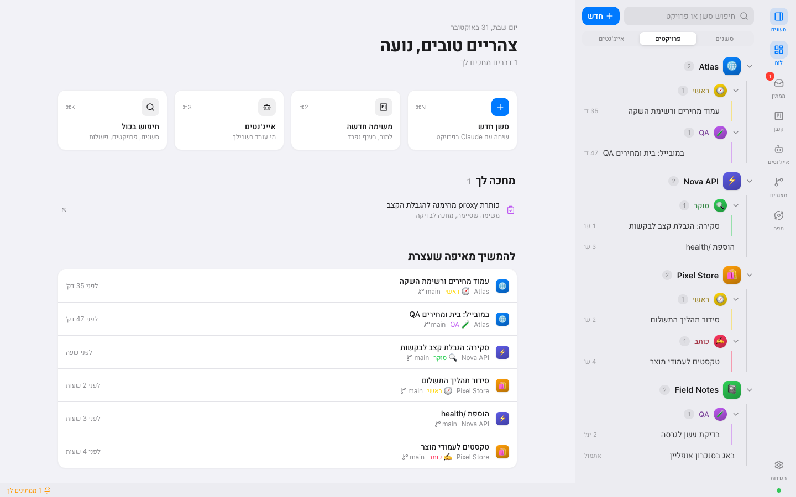
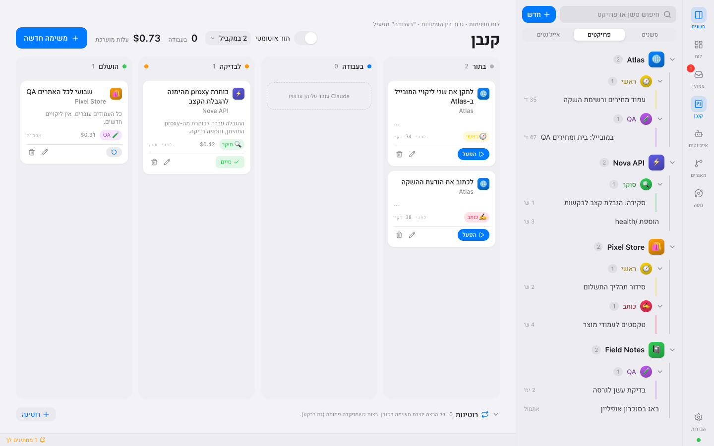
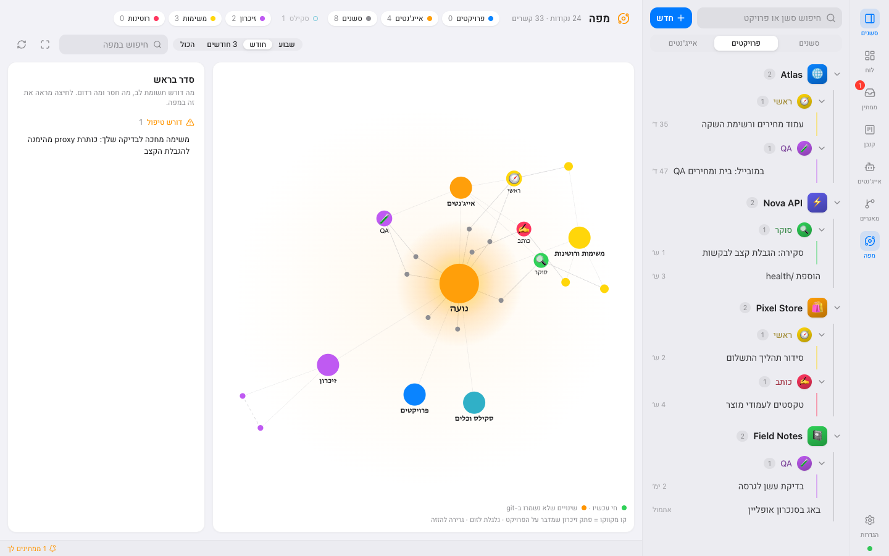
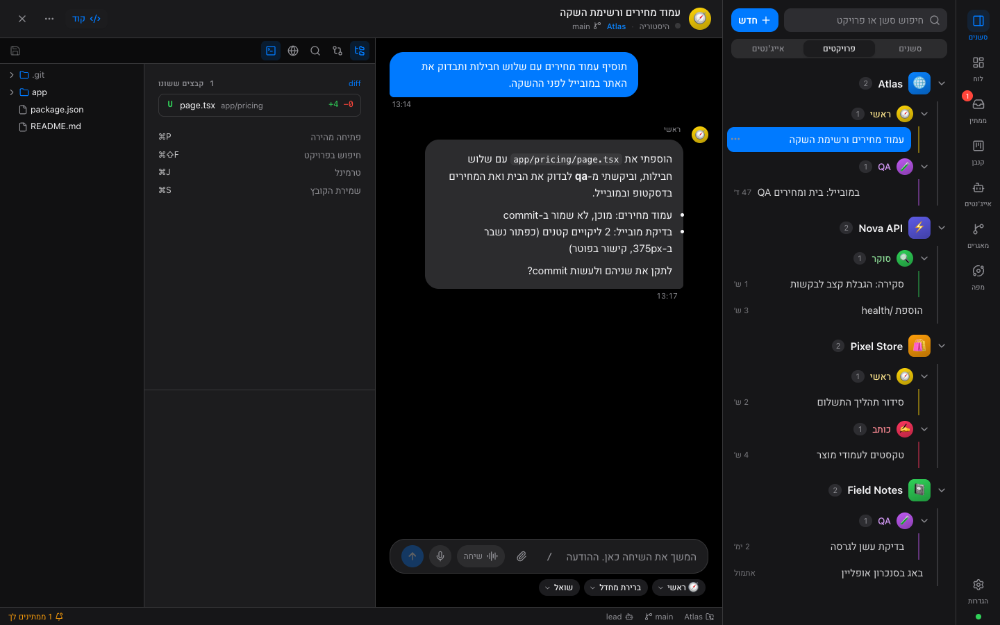
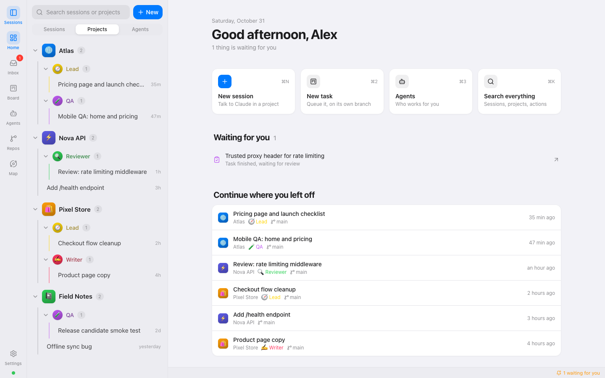
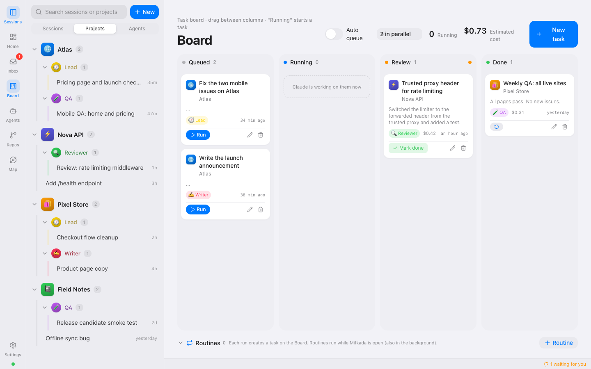
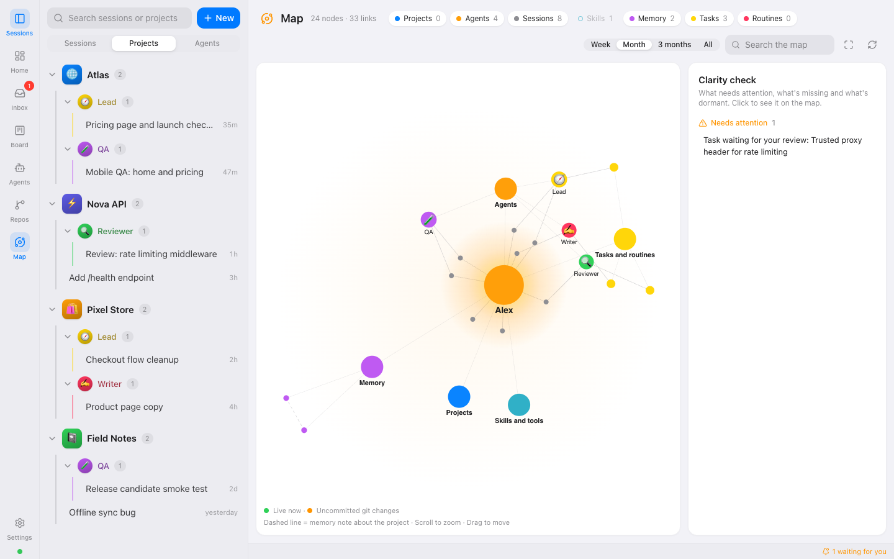
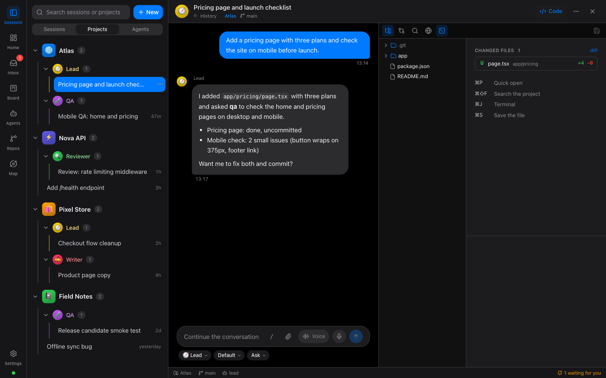

# מפקדה · Mifkada

**מרכז שליטה בעברית לכל סשני Claude Code שלך.** שיחות, אייג'נטים, משימות ופרויקטים במקום אחד, באפליקציית Mac
מקומית. בנוי על ה-[Claude Agent SDK](https://docs.claude.com/en/api/agent-sdk/overview) הרשמי ורץ על מפתח
API של Anthropic משלך (או Amazon Bedrock / Google Vertex AI).

> **הבהרה:** מפקדה היא פרויקט עצמאי ואינה קשורה ל-Anthropic, ואינה מאושרת או נתמכת על ידה. היא לא מספקת גישה
> ל-Claude: הסשנים רצים על מפתח ה-API שלך (חיוב לפי שימוש מול Anthropic), באחריותך ולפי
> [התנאים של Anthropic](https://www.anthropic.com/legal). "Claude" ו-"Claude Code" הם סימנים של Anthropic.

[English below](#english)



<table>
<tr>
<td></td>
<td></td>
<td></td>
</tr>
</table>

## מה יש בה

- **כל הסשנים במקום אחד:** גם אלה שנפתחו בטרמינל או ב-VS Code. רשימה לפי זמן, לפי פרויקט או לפי אייג'נט, חיפוש
  בתוך השיחות, ומסך מפוצל עד 6 צ'אטים.
- **אייג'נטים:** יצירה ועריכה של אייג'נטים של Claude Code (`~/.claude/agents`), צבע, אייקון ותמונה לכל אחד,
  ואייג'נט ברירת מחדל לסשן חדש.
- **קנבן משימות:** משימה = פרומפט + פרויקט + אייג'נט. תור אוטומטי, ענף git נפרד לכל משימה (worktree) עם מיזוג
  בלחיצה, רוטינות לפי שעה, ו"ממתין לך" לאישורים ולמשימות שסיימו.
- **בלי התנגשויות:** משימה בריפו שסשן אחר עובד בו עוברת לענף נפרד לבד, וסשן חדש מזהיר מי עוד עובד שם.
- **אישורים:** בקשת הרשאה של Claude הופכת לכרטיס עם הסבר בעברית. אפשר לאשר בלי לפתוח את הצ'אט.
- **לא רק Claude:** Codex (על מנוי ChatGPT), Copilot, Gemini, opencode, Cursor, Goose וכל סוכן שמדבר
  [ACP](https://agentclientprotocol.com), באותו קנבן, סיידבר ומסך מפוצל. כרטיסי אישור, המשך סשן, סשנים שהתחילו בטרמינל,
  סיכום וחיפוש. מוסיפים מהקטלוג של ACP Registry (הגדרות ← ספקים).
- **מראה של IDE:** כרטיסיות לשיחות פתוחות, שורת מצב, צבעי VS Code בבהיר ובכהה. העיצוב הקודם (iOS) זמין בהגדרות.
- **סביבת עבודה:** סייר קבצים, עורך (Monaco), diff, טרמינל ודפדפן מובנה לתצוגה מקדימה, בחלונות שאפשר לשנות
  את הגודל שלהם.
- **מפה:** גרף של כל הפרויקטים, האייג'נטים, הסשנים, הסקילס והזיכרון, ורשימת "מה חסר" (שינויים שלא נשמרו ב-git,
  פרויקטים בלי גיבוי, דברים רדומים).
- **קול:** הקראת תשובות ושיחה קולית רציפה. תמלול מקומי לגמרי עם whisper.cpp.
- **עברית אמיתית:** RTL מלא, וכל פסקה מקבלת כיוון לפי התוכן, כך שאנגלית וקוד נשארים קריאים. יש גם ממשק מלא באנגלית
  (הגדרות ← כללי ← שפה).

## הורדה והתקנה

הקבצים להורדה נמצאים בעמוד [Releases](https://github.com/edensitko/mifkada/releases) (כשאין שם קובץ למערכת שלך,
מתקינים מהקוד, ראו למטה):

- **Mac (Apple Silicon):** `Mifkada_<גרסה>_aarch64.dmg`. פותחים, גוררים ל-Applications. האפליקציה עוד לא חתומה ב-Apple,
  ולכן בפתיחה הראשונה: קליק ימני על האפליקציה ← פתח (או הגדרות המערכת ← פרטיות ואבטחה ← "פתח בכל זאת").
- **Linux (x86-64):** `Mifkada_<גרסה>_amd64.AppImage` (`chmod +x` והרצה) או `Mifkada_<גרסה>_amd64.deb`.
- **Windows:** `Mifkada_<גרסה>_x64-setup.exe` כשהוא מופיע שם. ניסיוני, עוד לא נבדק על מחשב אמיתי, והקובץ לא חתום
  (ב-SmartScreen: "מידע נוסף" ← "הפעל בכל זאת").

בהפעלה הראשונה מפקדה בודקת את הסביבה ומבקשת מפתח API של Anthropic
([ליצירת מפתח](https://console.anthropic.com/settings/keys)). המפתח נשמר רק במחשב שלך. אפשר להחליף או להסיר אותו
בהגדרות ← ספקים ← Claude.

**לפני ההתקנה צריך Claude Code מותקן במחשב** (`npm install -g @anthropic-ai/claude-code`, או
[המתקין הרשמי](https://docs.claude.com/en/docs/claude-code/setup)). האפליקציה מההורדה משתמשת בו ולא אורזת אותו.
Node.js כבר בתוך האפליקציה.

## דרישות

- macOS על Apple Silicon (M1 ומעלה), או Linux (נבדק על Debian). Windows: ניסיוני, עוד לא נבדק על מחשב אמיתי.
  אריזה: `npm run app` (Mac), `npm run app:linux` (AppImage), `npm run app:win` (מתקין).
- Claude Code מותקן (ראו למעלה). מפקדה בודקת שהגרסה שלו מספיקה ומודיעה אם לא.
- Node.js 24 ומעלה: רק להתקנה מהקוד, או כדי להתקין את Claude Code דרך npm.
- מפתח API של Anthropic ([console.anthropic.com](https://console.anthropic.com/settings/keys)): מכניסים במסך הפתיחה,
  או `ANTHROPIC_API_KEY` בסביבה. לחלופין Amazon Bedrock (`CLAUDE_CODE_USE_BEDROCK=1`) או Google Vertex AI
  (`CLAUDE_CODE_USE_VERTEX=1`) עם ההגדרות שלהם.
- לא חובה: סוכנים נוספים. Codex רץ דרך npx ומתחבר ל-ChatGPT בדפדפן בפעם הראשונה. כל ספק רץ על ההתחברות שלו.
- git. ‏GitHub CLI (`gh`) לא חובה, ל-PRs ול-CI בעמוד המאגרים.
- לקול (לא חובה): `brew install whisper-cpp ffmpeg` ומודל whisper (ברירת מחדל
  `~/whisper-models/ggml-large-v3-turbo-q5_0.bin`, או `WHISPER_MODEL=<נתיב>`).

## התקנה

כרגע מתקינים מהקוד:

```bash
git clone https://github.com/edensitko/mifkada.git
cd mifkada
npm install
npm run install:app     # בונה, אורז ל-Mifkada.app, מעתיק ל-/Applications ופותח
```

האפליקציה לא חתומה ב-Developer ID. אם macOS חוסם אותה בפתיחה הראשונה: לחיצה ימנית על האפליקציה ← "פתח".

בהפעלה הראשונה מפקדה בודקת את הסביבה ושואלת איך לפנות אליך ואיפה הפרויקטים שלך (תיקייה שכל תת-תיקייה שלה היא
פרויקט, למשל `~/projects`).

## פיתוח

```bash
npm run dev          # שרת (tsx watch) + Vite + חלון Electron עם רענון חם
npm run typecheck    # השרת, הממשק וה-desktop
npm test             # בדיקות השרת והממשק
```

המבנה: `server/` (Node + Hono + ws + Agent SDK), `web/` (React 19 + Vite + Tailwind 4 + zustand), `desktop/`
(Electron), `shared/protocol.ts` (החוזה בין השרת לממשק). פירוט, החלטות ומלכודות ב-[CLAUDE.md](CLAUDE.md).

## פרטיות ואבטחה

הכול נשאר במחשב: המשימות, ההגדרות והסיכומים בתיקיית הנתונים של האפליקציה, והסשנים ב-`~/.claude`. האפליקציה לא
פותחת פורט ברשת. "עוזרי רקע" (תקציר יומי ושיוך סשנים לפרויקט), שקוראים למודל בלי שביקשת, כבויים כברירת מחדל.
פירוט ב-[SECURITY.md](SECURITY.md).

## רישיון

[MIT](LICENSE)

---

## English

**Mifkada** ("headquarters" in Hebrew) is a local macOS control center for your Claude Code sessions: chats,
agents, a task board and projects in one Hebrew-first (RTL) app, built on the official Claude Agent SDK and running
on your own Anthropic API key (or Amazon Bedrock / Google Vertex AI). The interface is available in English and Hebrew.

> **Disclaimer:** Mifkada is an independent project. It is not affiliated with, endorsed by or supported by Anthropic.
> It does not provide access to Claude: sessions run on your own API key (usage billed by Anthropic), at your own
> responsibility and under [Anthropic's terms](https://www.anthropic.com/legal). "Claude" and
> "Claude Code" are trademarks of Anthropic.



<table>
<tr>
<td></td>
<td></td>
<td></td>
</tr>
</table>

**Highlights:** every session in one place (including ones started in a terminal or VS Code); agent management;
a task board where each task can run in its own git worktree and be merged with one click; automatic isolation when
another session already works in the same repo; permission requests as approval cards; other agents besides Claude
(Codex on a ChatGPT plan, Copilot, Gemini, opencode, Cursor, Goose, or any [ACP](https://agentclientprotocol.com) agent)
with approvals, resume, terminal-started sessions, summaries and search; an IDE look with tabs for open chats; a workspace with file tree,
Monaco editor, diffs, terminal and preview; a graph map of projects, agents, sessions, skills and memory; local
voice (whisper.cpp).

**Requirements:** macOS on Apple Silicon or Linux (tested on Debian; Windows is experimental), Claude Code installed
(`npm install -g @anthropic-ai/claude-code`; the downloadable app uses it and doesn't bundle it), Node.js 24+ only when installing from source, an Anthropic API key (entered on first launch or `ANTHROPIC_API_KEY`;
Bedrock and Vertex work through `CLAUDE_CODE_USE_BEDROCK` / `CLAUDE_CODE_USE_VERTEX`), git. Optional: `gh`, whisper.cpp + ffmpeg for voice.

**Download:** installers are on the [Releases](https://github.com/edensitko/mifkada/releases) page (Mac dmg, Linux AppImage / deb; a Windows installer is experimental and unsigned). The Mac app isn't notarized yet, so open it the first time with right-click → Open. If there is no file for your system yet, install from source. Install Claude Code first; on first launch Mifkada checks your setup and asks for an Anthropic API key ([create one](https://console.anthropic.com/settings/keys)), stored only on your machine.

**Install from source:** `npm install && npm run install:app` (Mac), `npm run app:linux` (AppImage) or `npm run app:win` (installer). The app is not notarized; on first launch use
right-click → Open. **Develop:** `npm run dev`, `npm run typecheck`, `npm test`.

The UI follows your system language by default; switch it in Settings → General → Language. Everything stays on your machine; see
[SECURITY.md](SECURITY.md). Licensed under [MIT](LICENSE).
